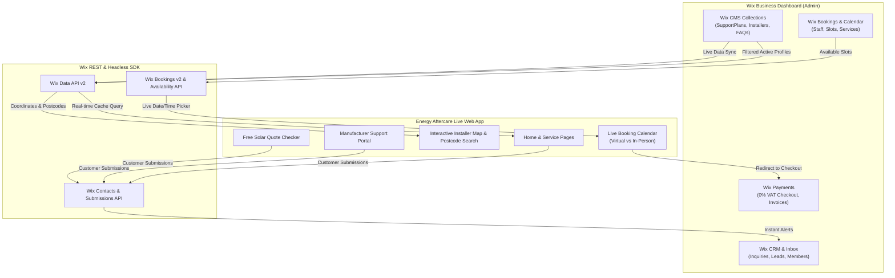
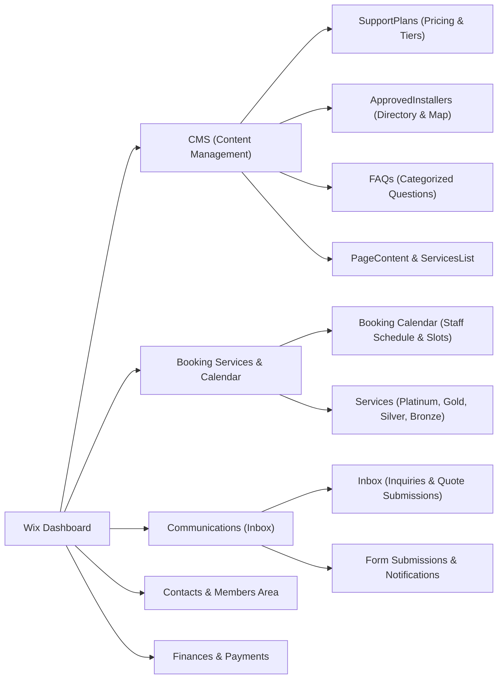
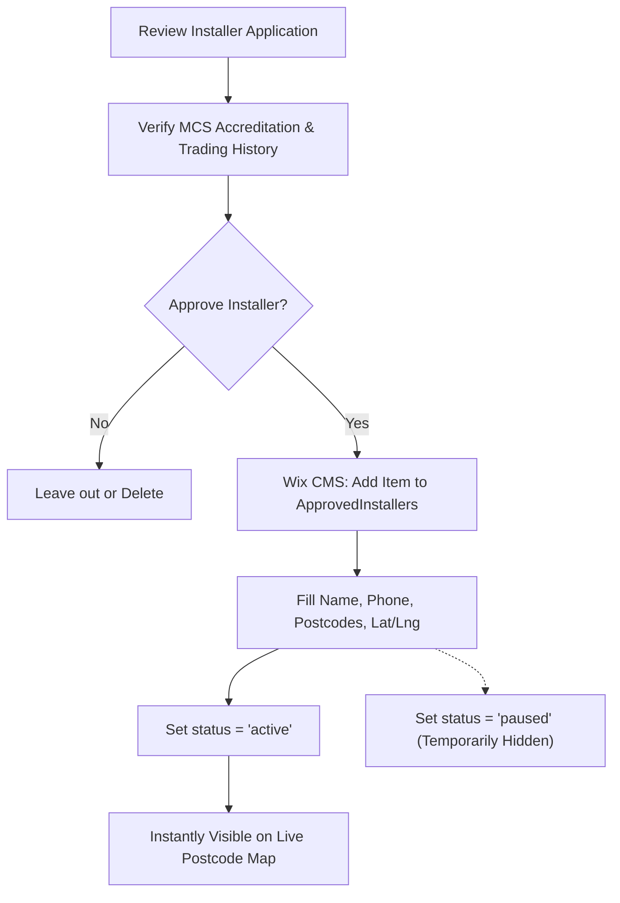
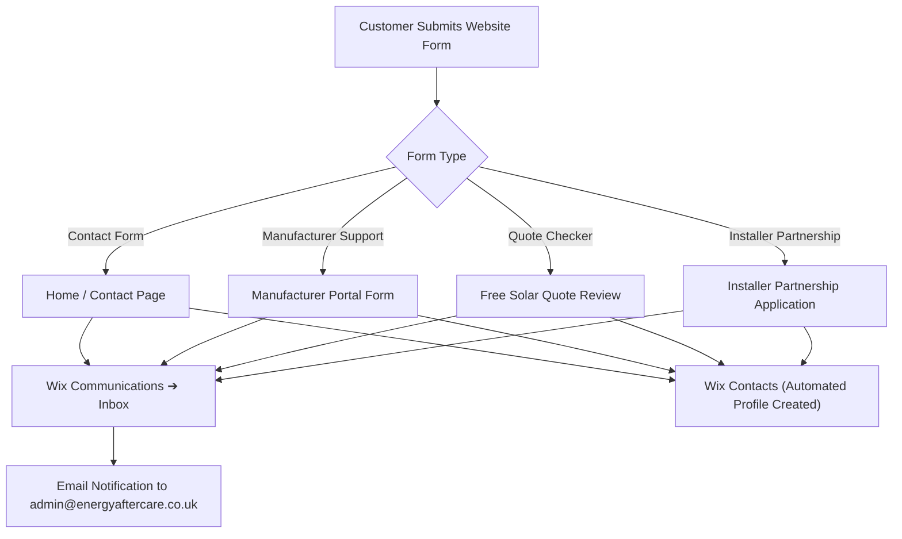

# Energy Aftercare — Wix Client Handover & Management Guide
**Document Version:** 1.0 (Production Release)  
**Target Platform:** Wix Headless Architecture with Wix Studio CMS, Bookings & CRM  
**Audience:** Josh & The Energy Aftercare Technical Management Team  
**Live Site URL:** [https://energy-aftercare-cmsscaleup-100a.wix-site-host.com](https://energy-aftercare-cmsscaleup-100a.wix-site-host.com)  

---

## 📌 Executive Summary & Architecture Overview

Energy Aftercare is built on a high-performance **Wix Headless Architecture**. This means your website enjoys the best of both worlds:
1. **Ultra-Fast Modern Frontend:** React, Tailwind CSS, and Vite deliver instant page loads, interactive calculators, and an interactive UK installer map.
2. **Centralized Wix Management Dashboard:** Your team has 100% control over pricing, plans, bookings, installer listings, FAQs, inquiries, and customer records directly from the familiar **Wix Business Dashboard** — without needing to write a single line of code.

### 🔄 End-to-End System Synchronization Flow

---

## 🗺️ Master Navigation Map in Wix Dashboard

When you log in to [manage.wix.com](https://manage.wix.com) and open **Energy Aftercare**, you will find all management tools on the left-hand navigation sidebar:

---

## 💎 Section 1: Managing Support Plans & Pricing (`SupportPlans`)

The four core Energy Aftercare plans (**Bronze**, **Silver**, **Gold**, **Platinum**) are stored in the Wix CMS collection named `SupportPlans`.

### 🧭 Navigation Path
> **Wix Dashboard** ➔ **CMS** ➔ **Collections** ➔ Click on **`SupportPlans`**

### 📋 Collection Fields & Schema
| Field Name | Type | Description | Live Display Impact |
|:---|:---|:---|:---|
| `name` | Text | Full plan title (e.g., `Bronze Support Plan`) | Displayed on Home, Services, and Book Online |
| `tier` | Text | Lowercase identifier: `bronze`, `silver`, `gold`, `platinum` | Controls visual theme, badges, and virtual vs. in-person logic |
| `price` | Text | Price string with symbol (e.g., `£79`, `£149`, `£299`, `£449`) | Displayed prominently across all pricing cards |
| `summary` | Text | 1-2 sentence core offering summary | Card header summary |
| `duration` | Text | Session or service duration description | Displayed on Booking Calendar summary box |
| `isVirtualOnly`| Boolean | `true` for Bronze/Silver; `false` for Gold/Platinum | Controls virtual appointment wording vs. engineer dispatch |
| `inclusions` | Tags / Array | Bullet points of exactly what is included throughout the year | Displayed as green tick checklist on cards & booking |
| `conditions` | Text | Eligibility, array limits (kWp/kWh), and coverage constraints | Displayed in terms box on booking confirmation |

### ✏️ Step-by-Step: How to Update a Plan's Price or Inclusions
1. Go to **CMS** ➔ **Collections** ➔ click **`SupportPlans`**.
2. Locate the row you wish to edit (e.g. *Bronze Support Plan*).
3. Click directly into the **`price`** cell to change the fee (e.g., from `£79` to `£89`).
4. Click into the **`inclusions`** cell to add, edit, or remove bullet points.
5. Hit **Enter** or click outside the cell. The CMS automatically saves the change.
6. The live website fetches updated CMS records on page reload.

> [!IMPORTANT]
> **Virtual vs. In-Person Rule:**
> - **Bronze & Silver** must always have `isVirtualOnly` set to `true`. This ensures customers see virtual consultation scheduling, remote telemetry instructions, and call joining details.
> - **Gold & Platinum** must have `isVirtualOnly` set to `false`. This enables physical engineer dispatch options and on-site inspection wording.

---

## 🛠️ Section 2: Managing the Approved Installers Directory (`ApprovedInstallers`)

Energy Aftercare features a selective, vetted network of MCS-certified solar and battery installers searchable by outward UK postcode and county on an interactive map.

### 🧭 Navigation Path
> **Wix Dashboard** ➔ **CMS** ➔ **Collections** ➔ Click on **`ApprovedInstallers`**

### 📋 Collection Fields & Schema
| Field Name | Type | Description & Example |
|:---|:---|:---|
| `name` | Text | Company legal / trading name (e.g. `Apex Renewables Ltd`) |
| `status` | Text | **`active`** (Published live) or **`paused`** (Hidden from public) |
| `tagline` | Text | Short marketing subtitle (e.g. `Premium Solar PV & Battery Specialists across the South West`) |
| `shortDescription` | Long Text | 2-3 sentence company biography and engineering credentials |
| `phone` | Text | Direct enquiry telephone (e.g. `+44 117 942 8110`) |
| `email` | Text | Direct enquiry email address |
| `website` | Text | Full URL (e.g. `https://www.apexrenewables.co.uk`) |
| `baseLocation` | Text | Town or City (e.g. `Bristol`) |
| `county` | Text | Primary county (e.g. `Bristol`, `Somerset`) |
| `lat` & `lng` | Number | Exact GPS coordinates for map pin (e.g. `51.4545`, `-2.5879`) |
| `coveredPostcodes`| Tags | Outward UK postcodes covered (e.g. `BS`, `BA`, `GL`, `SN`, `TA`) |
| `coveredCounties` | Tags | Counties covered (e.g. `Bristol`, `Somerset`, `Gloucestershire`) |
| `services` | Tags | `Solar PV`, `Battery Storage`, `EV Charging`, `System Upgrades` |
| `accreditations` | Tags | `MCS Certified`, `TrustMark`, `HIES Protected`, `RECC Member` |
| `mcsNumber` | Text | MCS accreditation registration number |
| `tradingYears` | Number | Years of verified operation |
| `rating` & `reviewCount` | Number | Independent review score (e.g. `4.9`, `142`) |

### ➕ Step-by-Step: Adding a New Approved Installer
1. Open **CMS** ➔ **Collections** ➔ **`ApprovedInstallers`**.
2. Click the blue **`+ Add Item`** button in the top right.
3. Fill in the installer's information:
   - **`name`**: Full Company Name.
   - **`status`**: Set to **`active`** to publish immediately, or **`paused`** to keep in draft.
   - **`lat` & `lng`**: Enter decimal latitude and longitude (e.g., from Google Maps) for the pin placement.
   - **`coveredPostcodes`**: Enter the 1 or 2 letter outward postcode prefixes they service (e.g., `BS`, `BA`, `GL`).
4. Click outside the row. The installer is now live and will appear when visitors search those postcodes!

### ⏸️ Step-by-Step: Temporarily Pausing or Hiding an Installer
1. Open **`ApprovedInstallers`**.
2. Double-click the **`status`** field for the installer.
3. Change `active` to **`paused`**.
4. The frontend code automatically hides paused installers from search results and the map.

---

## 📅 Section 3: Wix Bookings & Calendar Management

Energy Aftercare uses **Wix Bookings v2 API** to power online appointment scheduling. When a customer confirms a slot on the website, it is reserved in real-time in your Wix Calendar.

### 🧭 Navigation Path
> **Wix Dashboard** ➔ **Booking Services** (Service Catalog)  
> **Wix Dashboard** ➔ **Booking Calendar** (Daily / Weekly Schedule)

### ⚙️ How Booking Services Are Configured
There are 4 active appointment services in Wix Bookings:
1. **Bronze Support Plan:** 60 min virtual appointment slot.
2. **Silver Support Plan:** 90 min virtual diagnostic session.
3. **Gold Support Plan:** Up to 3 hours comprehensive service (virtual or on-site).
4. **Platinum Support Plan:** Up to 4 hours executive service (on-site).

### 🕒 Setting Staff Hours & Slot Availability
1. Go to **Booking Calendar** ➔ click **Staff** (or **Work Hours**).
2. Set default working hours (e.g., Monday – Friday, 09:00 to 17:00).
3. The live website automatically reads available time slots (`10:00`, `11:00`, `12:00`, `13:00`, `14:00`, `15:00`, `16:00`) based on staff availability.
4. **Blocking Holidays / Vacation:**
   - In the **Booking Calendar**, simply click any date or time range and choose **Block Time**.
   - Blocked hours will immediately disappear from the frontend date picker.

### 🔄 Handling Customer Rescheduling or Cancellations
1. Go to **Wix Dashboard** ➔ **Booking Calendar**.
2. Click on the customer's appointment.
3. You can:
   - **Reschedule:** Pick a new date and time. An automated notification email will be sent to the customer.
   - **Cancel Booking:** Click **More Actions** ➔ **Cancel**. Wix will automatically free up the slot for other customers and issue an email notification.

---

## 📥 Section 4: Wix CRM, Inbox & Customer Inquiries

Every form submitted on the Energy Aftercare website is routed to your Wix CRM and Wix Inbox in real time.

### 🧭 Navigation Path
> **Wix Dashboard** ➔ **Communications** ➔ **Inbox**  
> **Wix Dashboard** ➔ **Contacts**

### 📨 Where Specific Form Submissions Appear
1. **Manufacturer Support Inquiries:**
   - Subject / Header in Inbox: `[MANUFACTURER SUPPORT INQUIRY]`
   - Includes: Company Name, Products, Support Requirements, Contact Name, Email, Phone, and Project Details.
2. **Contact Form Submissions:**
   - General homeowner and installer queries sent via the homepage.
3. **Free Solar Quote Checker Leads:**
   - Homeowners requesting a second opinion or installer quote comparisons from the interactive checker.

### 🔔 Setting Up Instant Email & Mobile Notifications
1. Download the **Wix App** (iOS / Android) on your phone.
2. Log in with your Energy Aftercare admin account.
3. Turn on Push Notifications. You will receive an instant notification whenever a homeowner books a plan or a manufacturer submits an inquiry!
4. To configure staff email alerts: Go to **Settings** ➔ **Notifications** in the Wix Dashboard.

---

## 💳 Section 5: Wix Payments & Checkout Settings

All plan purchases redirect to the official, encrypted **Wix Hosted Checkout**.

### 🧭 Navigation Path
> **Wix Dashboard** ➔ **Finances** ➔ **Payments**

### 💷 Currency & 0% VAT Compliance
- **Currency:** Set to **GBP (£)**.
- **UK Renewable VAT Relief:** Under UK legislation, domestic renewable energy installations and associated maintenance services benefit from **0% VAT**.
- All plans are exclusively for residential homeowners, billed yearly (£79, £149, £299, £449 + 20% VAT as a service). The UI automatically displays the "+vat" notation.

---

## ❓ Section 6: Managing FAQs (`FAQs`)

The Solar, Battery & EV Charging FAQ page is dynamic and searchable.

### 🧭 Navigation Path
> **Wix Dashboard** ➔ **CMS** ➔ **Collections** ➔ Click on **`FAQs`**

### 📋 Adding or Editing Questions
- **`heading`:** Category tab (e.g. `GENERAL`, `HOMEOWNER SUPPORT`, `INSTALLER SUPPORT`, `SITE VISITS & ON-SITE SUPPORT`, `CONTACT & SUPPORT`, `SAFETY & RESPONSIBILITIES`).
- **`q`:** The question text.
- **`a`:** Answer text (can be multiline or bullet points with `•`).
- When a user clicks a category tab or types in the search bar on the website, it searches across all questions in real-time without refreshing or redirecting.

---

## 🌐 Section 7: Managing Page Text, Images & Site Settings (`PageContent`, `SiteSettings` & `ServicesList`)

To give Josh and the Energy Aftercare team complete freedom to customize any page's headings, introductory copy, buttons, badges, and imagery without developers, we have integrated three comprehensive CMS collections:

---

### 📄 1. Page Content & Media (`PageContent`)
> **Wix Dashboard** ➔ **CMS** ➔ **Collections** ➔ Click on **`PageContent`**

Every public page has a row identified by its unique **`pageKey`**:
- **`home`** — Homepage Hero, Calculator preview section, Services intro, and Support Plans banner
- **`about`** — About Us Page (Company origin, mission, values, and image)
- **`services`** — Services Overview Page (Advice, diagnostics, and homeowner packages)
- **`installer-support`** — Installer Support Page (Hero copy, value proposition, and hero image)
- **`manufacturer-support`** — Manufacturer Support Page (Partnership headline, intro, and hero image)

#### 📋 Full Field Reference for `PageContent`
| Field Name | Type | Description | Live Display Location |
|:---|:---|:---|:---|
| `pageKey` | Text (Key) | Unique identifier: `home`, `about`, `services`, `installer-support`, `manufacturer-support` | System routing key (Do not change) |
| `pageName` | Text | Human-friendly title (e.g. `Home Page`) | Dashboard reference only |
| `heroHeading` | Text | Main H1 title on the page | Page hero top title |
| `heroSubheading`| Text | Eyebrow text above the main title | Top green pill or eyebrow |
| `heroBody` | Long Text | Main introductory paragraph | Hero paragraph |
| `heroImage` | Image / Media | Upload any image from Wix Media Manager or paste an image URL | Displays in hero section (About, Installer, Manufacturer, Home) |
| `secondaryImage`| Image / Media | Secondary illustration or photo | Mid-page image slots |
| `heroPrimaryCta`| Text | Text on main primary button (e.g. `Get Support`) | Primary action button |
| `heroSecondaryCta`| Text | Text on secondary outline button (e.g. `About Us`) | Secondary button |
| `section2Heading`| Text | Title of the second section | Mid-page section title |
| `section2Subheading`| Text | Subtitle / eyebrow for section 2 | Mid-page badge |
| `section2Body` | Long Text | Paragraph copy for section 2 | Mid-page copy |
| `section3Heading`| Text | Title of the third section | Third section title |
| `section3Body` | Long Text | Paragraph copy for section 3 | Third section copy |
| `ctaHeading` | Text | Headline in bottom CTA banner | Bottom call-to-action banner |
| `ctaButtonText` | Text | Label for bottom CTA button | Bottom action button |
| `plansHeading` | Text | Section heading above the support plans | Pricing section title |
| `plansNotice` | Text | Badge above plans (e.g. `For Homeowners Only • Yearly Subscription`) | Green pill above plan cards |
| `plansDescription`| Long Text | Explanation text above the plan cards | Pricing section subtitle |
| `calculatorPreviewBadge` | Text | Badge on homepage calculator preview box | Free Online Solar Tool pill |
| `calculatorPreviewHeading`| Text | Headline inside calculator preview box | Calculator box headline |
| `calculatorPreviewBody` | Long Text | Description inside calculator preview box | Calculator box description |
| `calculatorPreviewButton` | Text | Button text inside calculator preview box | Calculator launch button |

#### 🖼️ How to Upload or Change Page Images in Wix CMS
1. In Wix Dashboard, navigate to **CMS** ➔ **Collections** ➔ **`PageContent`**.
2. Locate the page you want to update (e.g. `installer-support` or `about`).
3. Click on the **`heroImage`** cell.
4. Click **Add Media** (or **Replace Media**) to open the Wix Media Manager:
   - Select any image already uploaded to your Wix account, OR
   - Drag & drop a new photo from your computer (`.jpg`, `.png`, `.webp`).
5. Click **Apply**.
6. The frontend automatically translates the internal Wix media identifier into a high-speed CDN image URL (`https://static.wixstatic.com/media/...`) and displays it live on reload!

---

### 🌟 2. Homepage Services & Feature Cards (`ServicesList`)
> **Wix Dashboard** ➔ **CMS** ➔ **Collections** ➔ Click on **`ServicesList`**

Controls the 6 feature cards under the "Services" section on the homepage:
| Field Name | Type | Description | Options |
|:---|:---|:---|:---|
| `title` | Text | Feature title (e.g. `Solar Optimisation`) | Any title |
| `body` | Long Text | Feature description | 1-2 concise sentences |
| `iconName` | Text | Lucide icon name | `Sun`, `BatteryCharging`, `PlugZap`, `Activity`, `KeyRound`, `Compass` |
| `page` | Text | Target page | Set to `Home` |
| `order` | Number | Display position (1 to 6) | Numerical order |

---

### 🏢 3. Site-Wide Contact Info & Social Links (`SiteSettings`)
> **Wix Dashboard** ➔ **CMS** ➔ **Collections** ➔ Click on **`SiteSettings`**

Allows you to update global business details in a single location:
- **`companyName`**: `Energy Aftercare`
- **`phone`**: `+44 7943 812137` (used for header phone button and contact sections)
- **`email`**: `admin@energyaftercare.co.uk`
- **`officeHours`**: `Mon – Fri: 08:30 – 17:30`
- **`copyright`**: `© 2026 Energy Aftercare Ltd. All rights reserved.`
- **`facebookUrl`**, **`instagramUrl`**, **`youtubeUrl`**, **`xUrl`**, **`linkedinUrl`**: Social media profile links displayed in the website footer.

---

## ⚡ Section 8: Quick Reference Operational Cheat Sheet

| Task I Want to Perform | Exact Location in Wix Dashboard | Time to Take Effect |
|:---|:---|:---:|
| Change Support Plan price or bullet points | **CMS** ➔ **`SupportPlans`** | Instant on reload |
| Add a newly vetted installer to the UK map | **CMS** ➔ **`ApprovedInstallers`** ➔ `+ Add Item` (Status: `active`) | Instant on reload |
| Temporarily pause an installer listing | **CMS** ➔ **`ApprovedInstallers`** ➔ Set status to `paused` | Instant on reload |
| View incoming customer appointment | **Booking Calendar** ➔ View Day/Week Schedule | Real-time |
| Block staff time for holidays/weekends | **Booking Calendar** ➔ Click date/time ➔ `Block Time` | Real-time |
| View manufacturer or quote inquiry | **Communications** ➔ **Inbox** | Real-time |
| Add or edit a FAQ item | **CMS** ➔ **`FAQs`** ➔ Edit question/answer | Instant on reload |
| Update customer service phone/email | **CMS** ➔ **`SiteSettings`** | Instant on reload |

---

## 🔒 Section 9: Security & Handover Checklist

- [x] **SSL / HTTPS Encryption:** Full TLS 1.3 encryption across all pages and checkout flows.
- [x] **PCI-DSS Compliance:** All payments handled by Level-1 PCI compliant Wix Payment Gateway.
- [x] **Customer Privacy (GDPR):** Inquiries, CRM contacts, and quote submissions are stored in compliance with UK GDPR standards.
- [x] **Zero Code Dependency:** The Energy Aftercare operational team does not need technical developers to manage day-to-day business operations.

---
*For any additional developer support or platform questions, refer to the project repository or contact your engineering team.*
